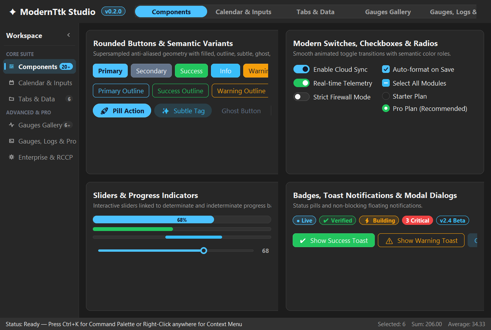
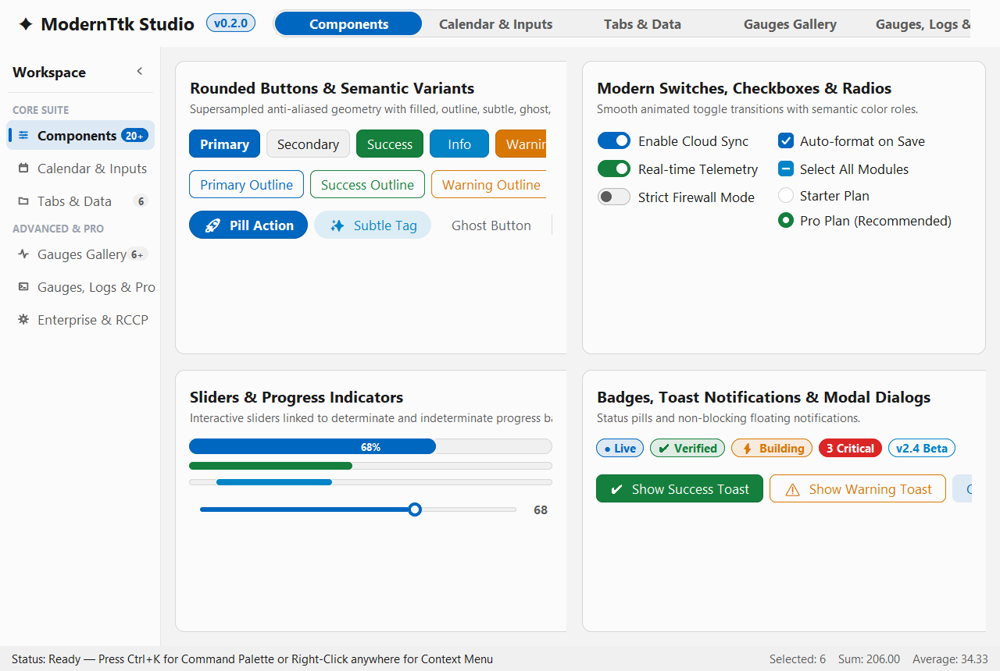
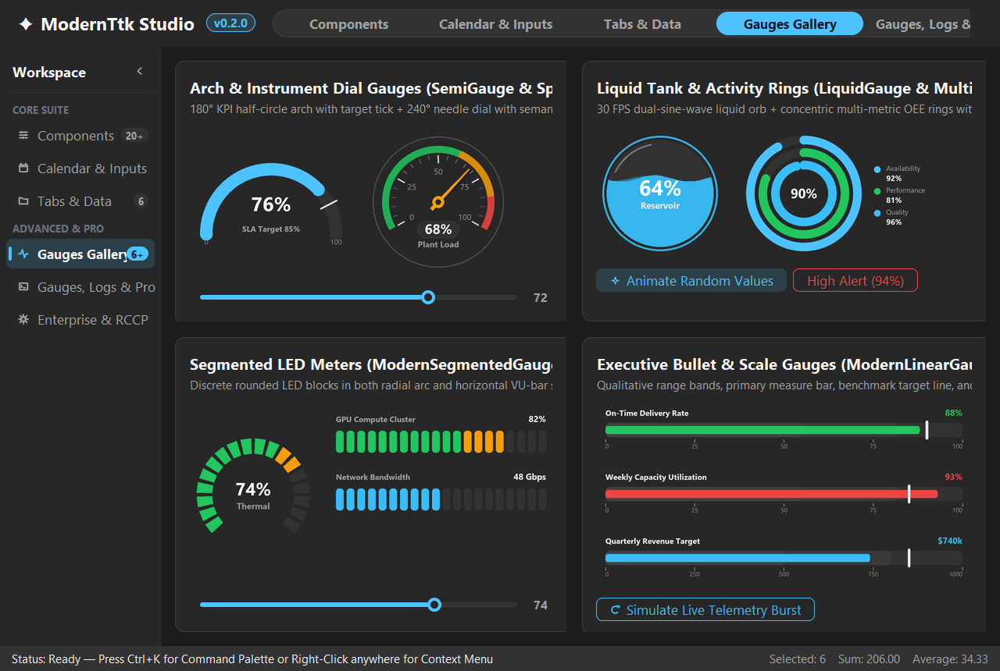
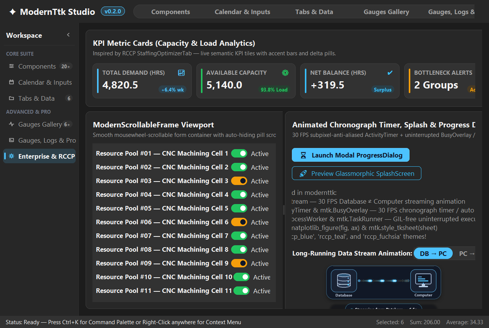

# ModernTtk

[](https://www.python.org/)
[](LICENSE)
[](https://python-pillow.org/)
[](https://github.com/asteng88/ModernTtk/releases)

**ModernTtk** is a hybrid Python Tkinter & `ttk` UI library that blends the clean **Windows 11 Fluent Design** surfaces of `sv_ttk` with the **semantic color roles and rich component suite** of `ttkbootstrap`—powered by supersampled Pillow (`PIL`) rendering for crisp, anti-aliased rounded corners, procedural vector icons, rich dashboard gauges, and smooth 30–60 FPS animations.

---

## Screenshots

| Core Components (`fluent_dark`) | Core Components (`fluent_light`) |
| :---: | :---: |
|  |  |

| Gauges Gallery (6+ Supersampled Gauges) | Enterprise, Chronograph Timer & Data Stream |
| :---: | :---: |
|  |  |

---

## Highlights

- **10 Built-In Themes + OS Auto-Detection**: `fluent_dark`, `fluent_light`, `cosmo`, `darkly`, `cyborg`, `minty`, `dracula`, `rccp_blue`, `rccp_teal`, `rccp_fuchsia`, plus `mtk.set_theme("system")` and custom JSON/dict palettes.
- **Zero-Refactor Legacy App Theming**: Call `mtk.auto_theme_tree(root)` to modernize an existing `tk`/`ttk` widget tree automatically.
- **40+ Procedural Vector Icons**: Render crisp theme-colored vector icons in memory (`mtk.icon("search")`, `icon="download"`, etc.) with zero external image files.
- **Rich Supersampled Gauge Suite**:
  - `Meter` (radial arc gauge with drag support), `SemiGauge` (180° executive KPI arch), `Speedometer` (240° needle dial with color zones), `SegmentedGauge` (LED arc & VU-bar), `LinearGauge` / `BulletGauge` (bullet & scale bar), `LiquidGauge` (30 FPS animated wave-fill orb), and `MultiRingGauge` / `ActivityRings` (concentric KPI rings).
- **High-DPI Chronograph Timer, Data Stream Animation & Uninterrupted Execution Engine**:
  - `ActivityTimer` (`ModernActivityTimer`) and `BusyOverlay` (`ModernBusyOverlay`) render a 36-frame subpixel-anti-aliased frosted glassmorphic chronograph medallion at an uninterrupted 30 FPS (`33 ms`).
  - `DataStream` (`ModernDataStream`) animates glowing data packets streaming between a **Database** and a **Computer** (`db_to_pc`, `pc_to_db`, or `bidirectional`). Both `BusyOverlay` and `ProgressDialog` support `animation="data_stream"` or `animation="auto"` (auto-transitioning after `long_running_threshold_sec`).
  - `SubprocessWorker` (`ModernSubprocessWorker`) and `TaskRunner` (`ModernTaskRunner`) offload GIL-holding native extensions to a persistent child process over binary stdio IPC so UI animations never stall.
- **35+ Supersampled Custom Widgets**:
  - **Navigation & Overlays**: `Sidebar`, `Notebook` (`underline`, `pills`, `cards`), `SegmentedButton`, `CommandPalette` (`Ctrl+K`), `ContextMenu` / `Menu` / `MenuButton`
  - **Inputs & Validation**: `Entry`, `SearchBar`, `PasswordEntry`, `Combobox`, `Spinbox`, `TagInput` / `Chips`, `Textarea` / `Text` (with line numbers & semantic logs), `Calendar` & `DatePicker`
  - **Enterprise & Analytics**: `DataTable` / `Treeview`, `Accordion` / `Expander`, `MetricCard`, `StatusBar`, `ScrollableFrame`, `ProgressDialog`, `Splash`, `Toast`, `Dialog`, `Badge`, `Tooltip`, plus `style_matplotlib_figure` and `style_tksheet` adapters.

---

## Installation

Install directly from GitHub:

```bash
pip install git+https://github.com/asteng88/ModernTtk.git
```

Or clone locally for development:

```bash
git clone https://github.com/asteng88/ModernTtk.git
cd ModernTtk
pip install -e .
```

---

## Quick Start

```python
import modernttk as mtk

app = mtk.ModernWindow(title="My Modern App", themename="system", geometry="720x480")

card = mtk.Card(app, title="Quick Settings", subtitle="Configure workspace preferences")
card.pack(fill="both", expand=True, padx=24, pady=24)

mtk.Switch(card.body, text="Enable Dark Mode", bootstyle="primary", command=mtk.toggle_theme).pack(anchor="w", pady=6)
mtk.TagInput(card.body, tags=["production", "us-east-1"], bootstyle="primary").pack(anchor="w", pady=8)

row = mtk.Frame(card.body)
row.pack(fill="x", pady=10)
mtk.Speedometer(row, value=72, size=150, subtext="Load").pack(side="left", padx=(0, 12))
mtk.LiquidGauge(row, value=64, size=150, subtext="Storage", bootstyle="info").pack(side="left", padx=(0, 12))
mtk.DataStream(row, direction="db_to_pc", autostart=True).pack(side="left")

mtk.Button(
    card.body,
    text="Save Configuration",
    icon="download",
    bootstyle="primary-pill",
    command=lambda: mtk.Toast.show(app, "Saved!", "Your preferences were updated.", bootstyle="success"),
).pack(anchor="w", pady=12)

app.mainloop()
```

---

## Running the Interactive 6-Page Showcase

```bash
python demo.py
```

---

## Documentation & Community

- **Full Developer Guide**: [`instructions.md`](instructions.md)
- **Changelog**: [`CHANGELOG.md`](CHANGELOG.md)
- **Contributing**: [`CONTRIBUTING.md`](CONTRIBUTING.md)
- **Code of Conduct**: [`CODE_OF_CONDUCT.md`](CODE_OF_CONDUCT.md)
- **Security Policy**: [`SECURITY.md`](SECURITY.md)

## License

Licensed under the [MIT License](LICENSE) © 2026 Andrew Thomas (`asteng88`).
